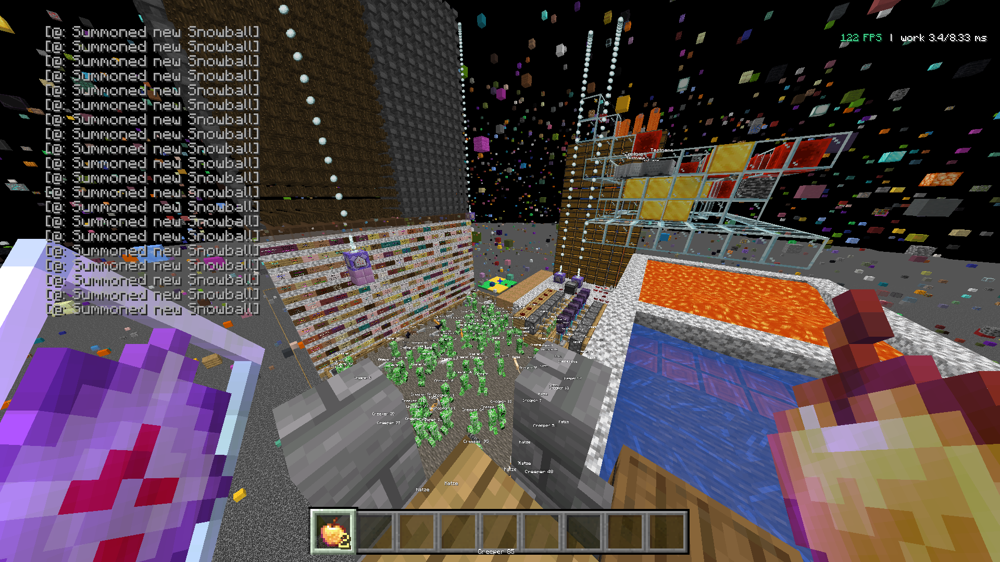

# Coral Client vs. Horizon, 2026-11-13

Frame rate and memory on the same test server, measured with MangoHud. The logs are in
`mangohud-2026-11-13/`. German version: `vergleich-horizon-2026-11-13.md`.

## Setup

*The test world. The screenshot was taken outside the measurement; the FPS counter in the image is
not part of the results.*

- **System:** AMD Ryzen 7 9700X, AMD Radeon RX 9060 XT, 16 GB RAM, Linux Mint 22.3,
  kernel 7.0.0-38, Mesa 26.2.5.
- **Server:** Fabric 1.21.11 with ViaFabric/ViaVersion. The test world is packed with entities,
  redstone clocks and command blocks.
- **Same conditions:**
  - both clients at the same spot, facing the same way;
  - time and weather frozen by gamerule (`advance_time false`, `advance_weather false`);
  - night vision via datapack;
  - 20 chat lines;
  - no resource pack;
  - uncapped frame rate, VSync off.
- **Settings:** matched beforehand. For Horizon: render distance 32, simulation distance 32,
  entity distance 5.0, biome blend 7, no clouds, GUI scale 3.
- **Versions:** Horizon nightly-2026-11-13-9f42064. Coral is a development build after v26.11.2,
  release profile.
- **Measurement:** MangoHud via `LD_PRELOAD`, recorded with Shift+F2, auto-stop after 30 s.
  Only full 30 s logs are evaluated.

## Frame rate

| Client | Log | Avg FPS | Median | p99 | 1 % low | 0.1 % low | Longest frame | GPU load / power |
|---|---|---|---|---|---|---|---|---|
| Horizon | `horizon-client_…_20-53-26` | 799 | 1.187 ms | 2.118 ms | 414 FPS | 272 FPS | 6.18 ms | 55 % / 53 W |
| Coral | `coral-client-…_21-02-43` | 969 | 0.985 ms | 1.491 ms | 577 FPS | 384 FPS | 3.80 ms | 69 % / 54 W |

How the values are computed:
- **Avg FPS:** number of frames divided by the sum of frame times.
- **1 % low and 0.1 % low:** mean of the slowest 1 % or 0.1 % of frames.
- `scripts/mangohud.py` computes avg FPS and 1 % low.

MangoHud's own `_summary.csv` uses a different method and shows slightly different values.

Coral delivers 21 % more frames on average than Horizon and 39 % more at the 1 % low.

## Memory

Measured per process:
- RAM: `/proc/<pid>/smaps_rollup`;
- VRAM and GTT: DRM fdinfo.

| Client | Uptime | PSS | RSS | Peak RSS | VRAM | GTT | Threads |
|---|---|---|---|---|---|---|---|
| Coral | 3 min | 909 MiB | 957 MiB | 1000 MiB | 658 MiB | 44 MiB | 49 |
| Horizon | 32 s | 784 MiB | 832 MiB | 891 MiB | 396 MiB | 8 MiB | 45 |

Horizon had only been running for 32 seconds, so its memory had probably not settled yet.

## Not evaluated

- Short logs stopped before 30 s: `20-45-22`, `20-55-55` and `20-57-12`.
- Logs from earlier sessions: `00-31-10` and `00-32-10`. They come from an older Coral build and
  were not recorded under the conditions above.
- **OneClient 2.5.1 (Fabric 1.21.11, Sodium):** 300–400 FPS were visible in game. No clean MangoHud
  log could be recorded, so it is not in the table.

## Coral with motion blur

All three motion blur types on (hand, entities, camera), otherwise as above. This value is not part
of the comparison with Horizon; it only shows what motion blur costs.

| Log | Avg FPS | Median | p99 | 1 % low | 0.1 % low | Longest frame | GPU load / power |
|---|---|---|---|---|---|---|---|
| `coral-client-…_22-16-19` | 505 | 1.866 ms | 3.463 ms | 271 FPS | 225 FPS | 6.99 ms | 100 % / 171 W |

The GPU is fully loaded here, so the frame rate is GPU-bound.
