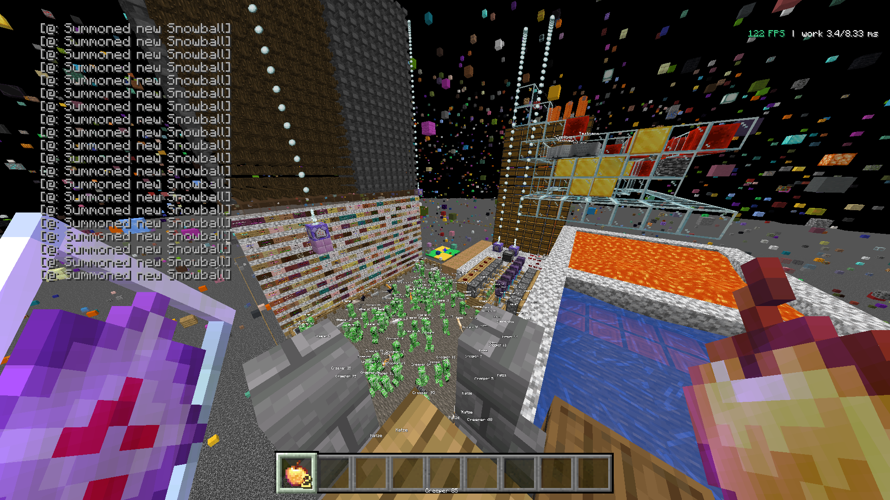

# Coral Client vs. Horizon, 2026-11-13

Gleiche Testwelt, gleicher Standort, gleiche Einstellungen, ohne FPS-Begrenzung, 30 s gemessen
mit MangoHud. Ryzen 7 9700X, RX 9060 XT, Linux.

| Client | Ø FPS | 1-%-Low | 0,1-%-Low | RAM | VRAM | GPU-Last | CPU-Last (gesamt) |
|---|---|---|---|---|---|---|---|
| Horizon | 799 | 414 | 272 | 832 MiB | 396 MiB | 55 % | 13 % |
| **Coral** | **969** | **577** | **384** | **957 MiB** | **658 MiB** | **69 %** | **11 %** |
| Fabulously Optimized (Xmx4096) | 571 | 214 | 155 | – | – | 50 % | 12 % |

Coral mit allem Motion Blur an (Hand, Entities, Kamera): 505 FPS im Schnitt, 271 FPS 1-%-Low.

Während der Messungen lief im Hintergrund ein YouTube-Video.

Logs: `mangohud-2026-11-13/`
